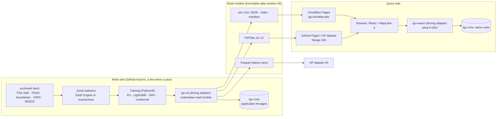
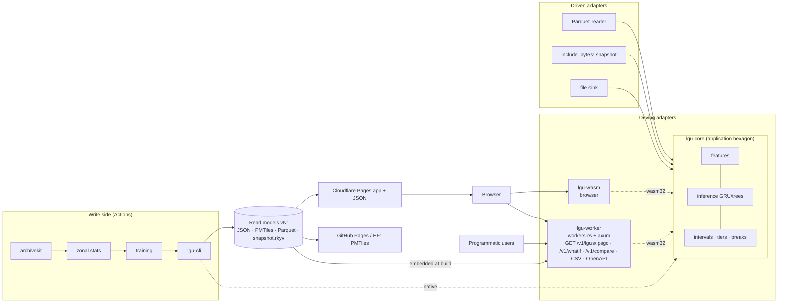
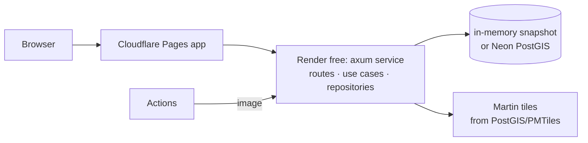

# LGU Lights: architecture research

Status: research and recommendations, 2026-10-21. Nothing is implemented. Versions and limits were checked on the day against crates.io, npm, vendor docs and release pages; **[U]** marks an estimate or a claim that could not be verified on a primary page. The 2026-10-21 measurement spike replaced the performance and size estimates with measurements ([SPIKE-RESULTS.md](SPIKE-RESULTS.md)); the few [U] left are outside its scope and are listed there. Companion documents: [PAPER-NOTES.md](PAPER-NOTES.md), [MODELING-PLAN.md](MODELING-PLAN.md), [DATA-PLAN.md](DATA-PLAN.md), [OPEN-QUESTIONS.md](OPEN-QUESTIONS.md).

Constraints this document works within:
- the backend is **Rust only**; optimise for **performance and accuracy**; the architecture must be **uniquely optimised for this project**, and the backend must follow a **named, widely recognised pattern** with its customisations written down (user direction, 2026-10-21);
- shared standards: Akari design system for the UI, `archivekit` for external data, free tiers first; the user now has a card on Render (free plan, overages would bill), owns `krtmtthw.dev` (subdomain `lgu.krtmtthw.dev` possible), and has Cloudflare, GitHub, Neon, Hugging Face and (unregistered) Earth Engine accounts;
- no heavy local computation.

## 0. Recommendation at a glance

**Architecture B, "Hexagonal core, materialised read models, edge API"**: one Rust workspace whose pure core (features, inference, intervals, classification) is driven by three adapters: a **CLI** that runs in GitHub Actions and *materialises* every result the site shows (per-LGU JSON, Parquet, PMTiles), a **WASM module** the browser calls for instant what-if sliders, and a **Cloudflare Worker (Rust/WASM)** that exposes the same core as a public JSON/CSV API with OpenAPI docs. The site is static (Cloudflare Pages at `lgu.krtmtthw.dev`); polygons are PMTiles on a host that honours Range requests; nothing in the critical path has a cold start or an overage path. Architecture A (the same without the Worker) is the fallback; C (a Render container) is documented and rejected.

Why it is uniquely optimal here, in one paragraph: the workload is **about 1,640 LGUs × 14 years × about 30 features ≈ 690k floats (about 2.75 MB)** plus a model with about 6k parameters whose forward pass costs 83,328 MACs (about 167k FLOPs; measured 11.5 µs native, 17 µs in browser WASM, [SPIKE-RESULTS.md](SPIKE-RESULTS.md) §4). That is small enough to precompute everything, embed the whole dataset in a WASM module, and run inference in well under a millisecond anywhere, including a browser tab and a Worker's 10 ms CPU budget. A database, a long-running server or a native ONNX runtime would add cold starts, egress and failure modes without improving a single number the user sees. What the project needs instead is **one tested Rust implementation of the maths, compiled three ways**, so the number on the map, the number from the API and the number under the slider are provably the same.

| Area | Recommendation | Runner-up |
|---|---|---|
| Accuracy | Forward-chaining leave-year-out validation (2018, 2021, 2023 folds), FH + LightGBM + GRU family, conformal intervals, three-tier reliability flags ([MODELING-PLAN.md](MODELING-PLAN.md)) | — |
| Data / ETL | Earth Engine (noncommercial, 150 EECU-h/month) for zonal statistics as the primary path, exactextract in Actions as the verified cross-check and the no-GEE fallback; Parquet feature store versioned on a Hugging Face dataset; `archivekit` registry for every upstream ([DATA-PLAN.md](DATA-PLAN.md)) | Local-only processing in Actions |
| Backend pattern | **Hexagonal (ports and adapters) core + CQRS-style materialised read models + Jamstack delivery** (§3.1) | Clean Architecture layering (more ceremony, same idea) |
| Backend runtime | Rust CLI in Actions + Rust→WASM in the browser + **workers-rs on Cloudflare Workers** (free: 100k req/day, 10 ms CPU, no overage) | Axum on Render free (60 s cold start, overage risk with the card) |
| Inference | **Hand-written GRU and tree evaluator in the core crate** (no deps, WASM-safe), verified in tests against `tract` 0.23.9 running the ONNX export | `tract` at runtime; `ort` rejected |
| Storage | Parquet (canonical) → Arrow IPC/rkyv snapshot embedded in the binaries; per-LGU JSON files; PMTiles. **No database** | Neon PostGIS for ad-hoc SQL only |
| Front end | Vite + React 19 + TanStack Router (typed URL state) + **MapLibre GL JS 6.15** (`global-state` year tween, fill-extrusion) + `pmtiles` 4.5 + react-scrollama + Akari | deck.gl (not needed at 1,640 polygons) |
| Hosting | Cloudflare Pages (app + JSON), PMTiles on GitHub Pages or the HF dataset (206 verified), Worker for the API | R2 (needs the checkout flow; flag) |
| Targets | LCP ≤ 2.5 s, INP ≤ 200 ms, CLS ≤ 0.1; initial JS ≤ 150 kB gzipped, map chunk ≈ 300 kB; static p50 20–60 ms / p99 ≤ 150 ms from PH on a warm connection (measured 46 / p95 68 ms; 156 / 178 ms on a fresh connection, [SPIKE-RESULTS.md](SPIKE-RESULTS.md) §6); API p50 ≤ 80 ms / p99 ≤ 200 ms warm (edge-function proxy measured 50 / p95 65 ms; 187 / 232 ms fresh); what-if < 1 ms compute | — |

## 1. Area: accuracy

Full treatment in [MODELING-PLAN.md](MODELING-PLAN.md). The architectural consequences:
1. **Five label rounds in the VIIRS era (2012, 2015, 2018, 2021, 2023).** PSA released a 2023 SAE on 2026-02-16 using Census EB and EOG nighttime lights (snippet-verified: [PSA](https://psa.gov.ph/content/881-cities-and-municipalities-recorded-poverty-incidence-20-percent-or-lower-2023), [Bohol repost](https://bohol.gov.ph/2026/02/16/more-bohol-towns-record-lower-poverty-incidence-in-2023-psa/)). The pipeline must treat label rounds as a growing list, not a fixed four.
2. **Expect modest lift from lights.** PSA's own 2018 test moved adjusted R² from 55.09 % to 55.52 % ([PSA at UNSD 2022](https://unstats.un.org/sdgs/files/meetings/sdg-inter-workshop-jan-2022/5.4-Use-of-Non-Traditional-Data-Sources-for-Philippine-SDG-Indicator-Monitoring-Philippines.pdf)); Yeh et al. 2020 find nightlights-only change prediction r² < 0.01 ([PMC](https://pmc.ncbi.nlm.nih.gov/articles/PMC7244551/)). The product must therefore be built around *honest comparison with official numbers*, which is a UI and data-model requirement (§5), not just a modelling one.
3. **Every served number carries an interval and a reliability tier**, so the read model (§3.4) has those columns from day one.

## 2. Area: data and ETL

Full treatment in [DATA-PLAN.md](DATA-PLAN.md) (sources, licences, volumes, the `archivekit` registry draft, cadence). The findings that shape the architecture:

| Option | Facts (verified 2026-10-21) | Recommendation |
|---|---|---|
| Earth Engine zonal statistics | Community tier 150 EECU-h/month since 2026-04-27, individuals eligible, service accounts allowed ([tiers](https://developers.google.com/earth-engine/guides/noncommercial_tiers), [service accounts](https://developers.google.com/earth-engine/guides/service_account)); VIIRS annual V2.2 on GEE covers 2012–2024 ([STAC](https://earthengine-stac.storage.googleapis.com/catalog/NOAA/NOAA_VIIRS_DNB_ANNUAL_V22.json)); EOG's own downloads are paid for programmatic use since 2026-06-01 ([EOG register](https://eogdata.mines.edu/products/register/)); raw MOD13Q1 tiles would be about 62 GB | **Primary**: a few EECU-hours per full rebuild **[U]** (not measured in the spike: GEE not yet registered; the exactextract fallback takes 78.5 s per product-year over full-resolution ADM3, [SPIKE-RESULTS.md](SPIKE-RESULTS.md) §5); no raster downloads |
| exactextract 0.3.0 in Actions | exact coverage fractions; public-repo runners are 4 vCPU / 16 GB ([runners](https://docs.github.com/en/actions/reference/runners/github-hosted-runners)); Black Marble annual composites are not on GEE, about 378 MB/year for the five PH tiles | **Secondary**: Black Marble and the GEE cross-check |
| Rust GDAL / SedonaDB | `gdal` 0.19.0 needs libgdal; SedonaDB `RS_ZonalStats` is centroid-based; no pure-Rust exactextract | Not for zonal statistics; the Rust backend starts at the feature table |
| Boundaries | HDX COD-AB PHL v03, CC BY-IGO, 1,642 ADM3 with 10-digit PSGC pcodes ([HDX](https://data.humdata.org/dataset/philippines-administrative-levels-0-to-3)); geoBoundaries simplified 7.07 MB as mirror | One analysis vintage + crosswalk; the eight 2024 BARMM municipalities and the 2022 Maguindanao split are mapped many-to-one |
| Labels | PSA SAE rounds through **2023** (presented 2026-02-16); CC BY per OpenSTAT terms ([terms](https://openstat.psa.gov.ph/Terms)), coverage of the SAE xlsx to confirm | Five VIIRS-era rounds |
| Versioning | Parquet in git + Zenodo DOI per release + HF dataset mirror; immutable `v<N>/` read-model folders with a pointer | Reproducible and citable at a few MB |
| Continuity risks | S-NPP deliveries end 2026-11-02 ([alert](https://www.earthdata.nasa.gov/data/alerts-outages/content/data-alert-history/22341)); Terra ends about February 2027 ([NASA](https://science.nasa.gov/science-research/earth-science/terra-the-end-of-an-era)) | Overlapping NOAA-20 (VJ146A4) and VNP13A1 series computed from day one so the offsets are estimated before the old sensors stop |

## 3. Area: the Rust backend

### 3.0 What is the backend *for* here?

Workload analysis (all numbers derived from the project's own sizes):

| Need | Shape | Cheapest correct mechanism |
|---|---|---|
| Show any LGU's 14-year series, official points with CIs, model estimates with intervals, reliability flags | read-only, identical for every visitor, changes a few times a year | **precomputed per-LGU JSON** (about 2–4 kB each, about 1,640 files, about 5 MB total) on a CDN |
| Map of all LGUs for any year, 3D extrusion, animation | 1,640 polygons with 14 numeric properties | **PMTiles** built offline (measured: 24.5 MB at z0–12 with 84 per-year slots, **5.9 MB at z0–10 with 42 slots** (value, tier, source), 428 kB per typical session, [SPIKE-RESULTS.md](SPIKE-RESULTS.md) §1; geoBoundaries' simplified PH ADM3 GeoJSON is 7.07 MB [verified via HEAD](https://www.geoboundaries.org/api/current/gbOpen/PHL/ADM3/)) |
| What-if sliders ("radiance grows 10 %/yr") | one GRU forward pass per slider move: 83,328 MACs for hidden 32, 30 inputs, 14 steps (measured 17 µs in Chrome WASM; all 1,640 LGUs 41 ms, [SPIKE-RESULTS.md](SPIKE-RESULTS.md) §4) | **in-browser WASM**, microseconds |
| Compare two LGUs, CSV export, programmatic access | occasional, small | static JSON is enough; an **API** adds OpenAPI docs and server-side CSV |
| Rebuild everything when PSA or VIIRS publishes | batch, a few times a year | **GitHub Actions** running the Rust CLI |

Conclusion: a long-running server is not required for any user-facing path. A server is *useful* for one thing only, a public, documented API, and on this workload that API can run as an edge function with hard, free limits. The "Rust backend" is therefore defined as **the Rust workspace that computes, materialises and serves every number**, with the deployment target chosen per adapter.

### 3.1 The standard pattern and its customisations

**Pattern chosen: Hexagonal architecture (Ports and Adapters) for the code, combined with CQRS-style materialised read models for the data flow, delivered Jamstack-style.**

- *Hexagonal*: Cockburn's 2005 pattern, intent "allow an application to equally be driven by users, programs, automated test or batch scripts, and to be developed and tested in isolation from its eventual run-time devices and databases"; primary (driving) adapters on one side, secondary (driven) adapters on the other, and "the asymmetry to exploit is … between inside and outside of the application" ([original article](https://alistair.cockburn.us/hexagonal-architecture/)). This is exactly the project's situation: the same application must be driven by a CI batch script, a browser and an HTTP edge function.
- *CQRS / Materialised View*: separate models for updating and reading ([Fowler](https://martinfowler.com/bliki/CQRS.html)); precomputed views "store the results of complex computations or queries without requiring the database engine or client to recompute for every request" ([Azure Architecture Center: Materialized View](https://learn.microsoft.com/en-us/azure/architecture/patterns/materialized-view), [CQRS](https://learn.microsoft.com/azure/architecture/patterns/cqrs)). Fowler's warning that most systems "should be done in [CRUD] style" and that CQRS is "a significant mental leap" is taken seriously: LGU Lights uses only the *read-model half*. There are no runtime commands at all; the only write is the pipeline run.
- *Jamstack*: "the entire front end is prebuilt into highly optimized static pages and assets during a build process" and served from a CDN, with APIs reached from the browser ([jamstack.org](https://jamstack.org/what-is-jamstack/)).
- Why not Clean Architecture as the headline: its concentric Entities / Use Cases / Interface Adapters / Frameworks rings and Dependency Rule ([Martin 2012](https://blog.cleancoder.com/uncle-bob/2012/08/13/the-clean-architecture.html)) describe the same dependency direction, but the Use-Case ring would hold one-line functions here; hexagonal names the thing that actually varies in this project (the driving adapter), so it communicates better. The Dependency Rule is still enforced by `Cargo.toml` (the core crate has no I/O dependencies).
- Why not a Lambda architecture: its batch, speed and serving layers ([Marz & Warren, summarised](https://motherduck.com/glossary/lambda-architecture/)) are for streaming data; LGU Lights has no speed layer. Its vocabulary is borrowed only to say "batch layer = Actions, serving layer = CDN".

**Standard → our variant**

| Hexagonal vocabulary | LGU Lights | Customisation and reason |
|---|---|---|
| Application (inside the hexagon) | crate `lgu-core`: feature engineering from zonal statistics, model inference (GRU, tree ensemble), interval and reliability computation, classification breaks, PSGC harmonisation rules, narration templating | **No async, no I/O, `no_std`-compatible where practical**, so it compiles to native and `wasm32` unchanged. Pure functions over `&[f32]` slices; this is the performance choice (no allocation in the hot path) |
| Driving (primary) ports | `Nowcast`, `WhatIf`, `Compare`, `Export` as plain Rust functions/traits | **Collapsed application layer**: there are no "use case" objects, because each use case is one function with no orchestration. Documented deviation from a textbook hexagon |
| Driving adapters | `lgu-cli` (Actions batch), `lgu-wasm` (browser, `wasm-bindgen`), `lgu-worker` (Cloudflare Workers, `workers-rs` + axum through its `http` feature) | Three adapters for one core is the point of the design: the same inference binary-for-binary |
| Driven (secondary) ports | `FeatureStore` (read features), `ModelWeights` (read a model), `ReadModelSink` (write outputs) | `FeatureStore` has exactly two implementations (Parquet in CI, embedded Arrow IPC/rkyv bytes in WASM), which is the only reason it is a trait. No repository abstraction over a database, because there is no database |
| Driven adapters | `parquet` crate reader; `include_bytes!` snapshot; filesystem writer (JSON, Parquet, GeoJSON for tippecanoe) | — |
| CQRS write side | the pipeline run (Python/R training + Rust CLI materialisation) | **Offline only**; the command is "rebuild data version N" |
| CQRS read models | per-LGU JSON, `index.json`, `manifest.json`, PMTiles with per-year properties, CSV bundle | Immutable, versioned folders with a pointer file (same atomic-publish rule as DATA-ARCHIVING.md §5) |
| Query side | CDN (Pages) for files; Worker for the API; browser WASM for what-if | Each reads the same read models; none computes anything the CLI did not already compute, except the what-if deltas |

### 3.2 Frameworks (verified on crates.io, 2026-10-21)

| Crate | Version | Use here | Notes |
|---|---|---|---|
| axum | 0.8.9 (2026-04-14) | HTTP routing in the Worker adapter (via `workers-rs` `http` feature) and in the optional Render variant | tokio 1.54.0, hyper 1.12.0. Independent benchmarks: 178,795 req/s at 64 connections, p50 0.36 ms, p99 0.61 ms ([the-benchmarker, 2026-10-06](https://web-frameworks-benchmark.vercel.app/frameworks/rust/axum/)); about 16.5 MB memory in a small-load test ([sharkbench](https://sharkbench.dev/web/rust-axum)) |
| actix-web | 4.17.0 (2026-10-15) | not used | about 15–20 % faster on hello-world ([the-benchmarker](https://web-frameworks-benchmark.vercel.app/frameworks/rust/actix/)); its own runtime and middleware ecosystem; cannot run inside Workers |
| pingora | 0.9.0 (2026-09-09) | not used | a proxy framework ("HTTP/1 and HTTP/2 end-to-end proxying", caching "experimental", [README](https://github.com/cloudflare/pingora/blob/main/README.md)); no routing/extractors for an app API |
| worker (workers-rs) | 0.8.7 (2026-09-25) | the edge adapter | "no Tokio or async_std support"; axum/hyper usable via the `http` feature ([README](https://github.com/cloudflare/workers-rs/blob/main/README.md)) |
| salvo 1.0.1 / poem 3.1.12 / rocket 0.5.1 | — | not used | poem's last release 2025-07; rocket's 2024-05 |

TechEmpower was archived on 2026-03-24 after Round 23 ([secondary](https://dev.to/kaliumhexacyanoferrat/techempower-framework-benchmarks-are-now-archived-whats-next-3l0a)); HttpArena is its successor (axum: 1.08 M req/s at 4,096 connections, p99 6.68 ms, 192 MiB RSS under load, [http-arena](https://www.http-arena.com/frameworks/axum/)). For LGU Lights the framework's throughput is irrelevant (the dataset is 2.75 MB and reads are CDN-cached); the choice is about **ecosystem and portability**, and axum is the only one that runs unchanged on Workers and on a container.

### 3.3 Inference in Rust

| Option | Version | GRU support | WASM | Size / cost | Verdict |
|---|---|---|---|---|---|
| **Hand-written GRU + tree evaluator in `lgu-core`** | — | by construction | yes, zero deps | weights a few kB; 83,328 MACs per forward: measured **11.5 µs native, 16.6–29 µs in WASM** (Chrome 156, opt-level 3+simd128 to z); equals tract to 5.96e-7 ([SPIKE-RESULTS.md](SPIKE-RESULTS.md) §4) | **Primary.** Fastest, smallest, and the same code runs in CI, browser and Worker |
| tract (`tract-onnx`) | 0.23.9 (2026-10-15) | yes: GRU/LSTM/RNN ops, fused `GruSeq` since 0.23.8 ([CHANGELOG](https://github.com/sonos/tract/blob/main/CHANGELOG.md)) | yes (wasm32, simd128, [README](https://github.com/sonos/tract/blob/main/README.md)) | pure Rust, larger binary | **Test oracle**: CI loads the Keras→ONNX export in tract and asserts the hand-written pass matches to 1e-5. Runner-up for runtime if ONNX must stay the artefact |
| burn / burn-onnx | 0.22.1 (2026-10-20) | GRU, LSTM, RNN listed ([SUPPORTED-ONNX-OPS](https://raw.githubusercontent.com/tracel-ai/burn-onnx/main/SUPPORTED-ONNX-OPS.md)) | yes | build-time codegen, heavy dependency tree | Not needed |
| candle / candle-onnx | 0.11.0 (2026-06-26) | ONNX import has LSTM and RNN but **no GRU** arm ([eval.rs](https://raw.githubusercontent.com/huggingface/candle/main/candle-onnx/src/eval.rs)) | yes | — | Rejected |
| ort | 2.0.0-rc.15 (2026-10-19), binds ONNX Runtime 1.31 | yes | only via experimental alternative backends ([backends](https://ort.pyke.io/backends)) | CPU-only `libonnxruntime` about 20 MB installed (Arch package, [secondary](https://packages.cachyos.org/package/extra/x86_64/onnxruntime-cpu)) | Rejected: 20 MB of runtime for 6k parameters |
| Trees | `lightgbm` 0.2.3 (2021, FFI) stale; `gbdt` 0.1.3; `linfa` 0.8.1 has no GBDT | — | — | — | Dump LightGBM trees to JSON and evaluate them in about 40 lines of core code; ONNX `TreeEnsembleRegressor` is deprecated in ai.onnx.ml v5 ([onnx.ai](https://onnx.ai/onnx/operators/onnx_aionnxml_TreeEnsembleRegressor.html)) |

Browser alternatives rejected: onnxruntime-web 1.30.0 ships a 14.2 MB WASM (28.3 MB for WebGPU) and its WebGPU operator table lists no GRU/LSTM ([webgpu-operators.md](https://unpkg.com/onnxruntime-web@1.30.0/docs/webgpu-operators.md), [dist listing](https://app.unpkg.com/onnxruntime-web@1.30.0/files/dist)); TensorFlow.js's last release is 4.22.0 from 2024-10-21 ([releases](https://github.com/tensorflow/tfjs/releases)). The prior proposal's TF.js plan is therefore dropped.

Accuracy guard: the training pipeline exports weights as JSON/binary **and** ONNX; a CI test runs 1,000 random inputs through tract (ONNX) and the core (weights) and fails on any divergence > 1e-5, so the served numbers equal the trained model.

### 3.4 Storage and caching

| Option | Verified facts | Fit |
|---|---|---|
| **Parquet (canonical feature store) via `parquet` 60.0.0 / `arrow`** | [crates.io](https://crates.io/api/v1/crates/parquet) | **Yes**: typed, columnar, compressed, readable by pandas/R/DuckDB for research, and by Rust in CI |
| **Embedded snapshot (Arrow IPC or `rkyv` 0.8.18) in the WASM/CLI binaries** | 2.75 MB raw; `rkyv` is zero-copy ([crates.io](https://crates.io/api/v1/crates/rkyv)) | **Yes**: no network hop, no cold start; loads in < 10 ms (measured 0.4–2 ms decode in WASM, 5.2 ms first Worker request, [SPIKE-RESULTS.md](SPIKE-RESULTS.md) §3–4) |
| duckdb-rs 1.10506.1 (DuckDB 1.5.6), DuckDB-WASM 1.32.0 | `bundled` compiles DuckDB from source; DuckDB-WASM is 34–39 MB uncompressed ([registry](https://registry.npmjs.org/@duckdb/duckdb-wasm), jsdelivr sizes) | No: an analytical engine for 690k values is pure overhead. (Typhoon Replay uses DuckDB-WASM for terabyte-derived data; that is why it is right there and wrong here) |
| SQLite (rusqlite 0.40.2) / Turso (libsql 0.10.0; free: 5 GB, 500 M row reads/month) | [Turso pricing](https://turso.tech/pricing) | No for serving (an extra network hop); possible as a local analysis file |
| Neon PostGIS (free: 100 CU-h/project/month, 1 GB, scale-to-zero after 5 min, cold start "a few hundred milliseconds", PostGIS 3.6.4 on PG18, Singapore) | [plans](https://neon.com/docs/introduction/plans), [scale-to-zero](https://neon.com/docs/introduction/scale-to-zero), [extensions](https://neon.com/docs/extensions/pg-extensions) | Optional for ad-hoc spatial SQL during research; never in the serving path |
| Cache | Cloudflare CDN cache for files (immutable, versioned paths, `Cache-Control: public, max-age=31536000, immutable`); the Worker holds everything in memory, so `moka` is unnecessary | — |

### 3.5 Deployment options (verified 2026-10-21)

| Host | Facts | Cold start | Overage risk with a card | Verdict |
|---|---|---|---|---|
| **Cloudflare Workers (free)** | 100,000 req/day, 10 ms CPU/request, 128 MB per isolate, 1 s startup, 50 subrequests ([limits](https://developers.cloudflare.com/workers/platform/limits/)); script size 64 MiB uncompressed on Free and Paid, "no compressed size limit" (verified on the official limits page, last updated 2026-10-12; spike Worker uploads 3.46 MiB, [SPIKE-RESULTS.md](SPIKE-RESULTS.md) §3) | milliseconds ([how Workers work](https://developers.cloudflare.com/workers/reference/how-workers-works/)) | **None**: hard fail at the cap (error 1027) | **API adapter** |
| **Cloudflare Pages / Workers Static Assets** | static requests "free and unlimited"; 20,000 files, 25 MiB per file ([Pages limits](https://developers.cloudflare.com/pages/platform/limits/), [static assets](https://developers.cloudflare.com/workers/static-assets/billing-and-limitations/)); **Pages returns 200, not 206, to Range requests** ([serving Pages](https://developers.cloudflare.com/pages/configuration/serving-pages/)) | none | none | **App + JSON read models**; not PMTiles |
| GitHub Pages | 1 GB site, 100 GB/month soft bandwidth ([limits](https://docs.github.com/en/pages/getting-started-with-github-pages/github-pages-limits)); **206 + `accept-ranges: bytes` verified today** | none | none | **PMTiles host** (primary) |
| Hugging Face dataset | 302 to CDN then **206 verified today**; public storage "best-effort" free ([storage limits](https://huggingface.co/docs/hub/storage-limits)) | none | none | Versioned Parquet + PMTiles fallback base URL |
| Cloudflare R2 | 10 GB-month, free egress ([pricing](https://developers.cloudflare.com/r2/pricing/)); enabling requires "the checkout flow to add an R2 subscription" ([get started](https://developers.cloudflare.com/r2/get-started/)) | none | low, but a payment method is reportedly prompted | Flagged decision (OPEN-QUESTIONS Q6) |
| Render free | 750 instance-hours/month, 0.1 CPU / 512 MB, spin-down after 15 min, spin-up "about one minute"; **with a payment method on file, bandwidth/pipeline overages bill a "supplementary amount"** ([free docs](https://render.com/docs/free)); Hobby bandwidth cut to 5 GB/month on 2026-08-01, $0.15/GB ([secondary](https://jwatte.com/blog/render-com-platform-review.md)) | about 60 s | **Yes** (bandwidth, build minutes) | Documented variant C; not recommended |
| Fly.io / Railway / Koyeb / Shuttle | no free tier ([Fly](https://docs.fly.io/about/pricing/)); $1 credit/month ([Railway](https://docs.railway.com/reference/pricing/plans)); one free 512 MB service in EU/US with card pre-auth reported **[U]** (rejected option; not measured in the spike); Shuttle is "ceasing operations" ([shutdown](https://docs.shuttle.dev/docs/shuttle-shutdown.md)) | — | — | Rejected |

### 3.6 Latency targets and why they hold

| Path | Mechanism | p50 / p99 target (PH user) | Basis |
|---|---|---|---|
| App shell, JSON read models | Cloudflare CDN (served from SIN for this connection) | 20–60 ms / ≤ 150 ms warm; measured 46 / p95 68 ms warm, 156 / 178 ms fresh ([SPIKE-RESULTS.md](SPIKE-RESULTS.md) §6) | static edge hit; no origin |
| Tiles | PMTiles range requests from GitHub Pages (Fastly) | 50–120 ms per tile / ≤ 250 ms; measured 36–39 / p95 42–43 ms warm, 117–131 / p95 134–143 ms fresh ([SPIKE-RESULTS.md](SPIKE-RESULTS.md) §6); the root directory sits in the first 16,384 bytes ([PMTiles v3 spec](https://github.com/protomaps/PMTiles/blob/main/spec/v3/spec.md)) | one range per tile after the header; warmed with an early `fetch` of bytes 0–16383 |
| API | Worker, in-memory snapshot, hand-written inference | ≤ 80 ms / ≤ 200 ms warm; measured via a Pages Function 50 / p95 65 ms warm, 187 / 232 ms fresh; handler + GRU + JSON ≈ 0.1 ms ([SPIKE-RESULTS.md](SPIKE-RESULTS.md) §3, §6) | isolate start in ms; no DB |
| What-if | browser WASM | < 1 ms compute per LGU (17 µs); a whole-map recompute is 41 ms, so it runs off the main thread | 83,328 MACs ([SPIKE-RESULTS.md](SPIKE-RESULTS.md) §4) |
| Rebuild | Actions | minutes | tiny data |

These were estimates; the 2026-10-21 spike measured them ([SPIKE-RESULTS.md](SPIKE-RESULTS.md)). Targets now apply to warm connections; the first request to each origin pays about 90 ms of TCP+TLS to Singapore, hence `preconnect` to the tile and API hosts.

## 4. Area: front end

Verified versions and facts (2026-10-21):
- **MapLibre GL JS 6.15.0** (2026-10-18): WebGL2 required, ESM-only since 6.0.0 (2026-07-22), 293.9 kB gzipped ([releases](https://github.com/maplibre/maplibre-gl-js/releases), [bundlephobia](https://bundlephobia.com/api/size?package=maplibre-gl@6.15.0)); globe since v5; `fill-extrusion-height/-base/-color` are data-driven; **`global-state` expressions** (`map.setGlobalStateProperty`) let one numeric `t` interpolate across per-year properties with no per-feature calls ([state spec](https://maplibre.org/maplibre-style-spec/state/), [layers spec](https://maplibre.org/maplibre-style-spec/layers/)); `flyTo` already honours reduced motion unless `essential: true` ([Map API](https://maplibre.org/maplibre-gl-js/docs/API/classes/Map/)). WebGPU: not mentioned in any 2026 release ([newsletter](https://maplibre.org/news/2026-09-02-maplibre-newsletter-august-2026/)).
- **pmtiles 4.5.0** npm; protocol registered once per app ([docs](https://docs.protomaps.com/pmtiles/maplibre)).
- **deck.gl 9.4.0** (2026-09-05): WebGPU "not recommended for production"; `@deck.gl/maplibre` supports maplibre ^6 ([what's new](https://deck.gl/docs/whats-new)). Not needed for 1,640 extruded polygons (building layers routinely draw tens of thousands); it would add about 125 kB+ gzipped.
- Basemaps: OpenFreeMap `dark` and `fiord` styles return 200 today, no key, no limits ([openfreemap](https://openfreemap.org/quick_start/)); Protomaps PH extract via `pmtiles extract --bbox=116.9,4.5,126.6,21.2 --maxzoom=12` as a self-hosted fallback (measured with `--dry-run` on build 20261020: 77 MB at z0–12, 15 MB at z0–10, [SPIKE-RESULTS.md](SPIKE-RESULTS.md) §1); terrain from Mapterhorn (Terrarium WebP, z0–17, Cloudflare-sponsored, [data access](https://mapterhorn.com/data-access)) or AWS Terrain Tiles.
- Scrollytelling: **react-scrollama 2.4.2** (IntersectionObserver, React 19 peer) for step triggers; GSAP 3.15 is now free for commercial use including ScrollTrigger ([license](https://gsap.com/community/standard-license/)) if pinned/scrubbed sequences are wanted; CSS `animation-timeline` is at 87.84 % support and not Baseline ([caniuse](https://caniuse.com/mdn-css_properties_animation-timeline)), so it is used only for progressive enhancement.
- Narration: `speechSynthesis` at 95.9 % support ([caniuse](https://caniuse.com/speech-synthesis)); iOS requires a user gesture; Filipino voices exist on Android (Google TTS) and in Edge (Azure `fil-PH-BlessicaNeural` / `AngeloNeural`, [Azure voice list](https://learn.microsoft.com/en-us/azure/ai-services/speech-service/language-support?tabs=tts)) but **not on Apple platforms** ([Apple VoiceOver languages, archived 2023](https://support.apple.com/en-ae/101364)). Open pre-rendered voices: Piper has no Filipino or Japanese ([VOICES.md](https://github.com/rhasspy/piper/blob/master/VOICES.md)); Kokoro-82M (Apache-2.0) has Japanese, no Tagalog ([VOICES.md](https://huggingface.co/hexgrad/Kokoro-82M/blob/main/VOICES.md)); Meta MMS-TTS `tgl` is **CC-BY-NC 4.0** ([model card](https://huggingface.co/facebook/mms-tts-tgl)). Pre-rendering 1,640 × 3 min of audio would be about 0.6–1.2 GB **[U, arithmetic]** (moot: captions-first; not measured in the spike): infeasible and pointless. **Decision: captions-first, templated narration**; Web Speech when a `fil`/`tl` voice exists; optional pre-rendered chapter intros (≤ 100 clips) for EN/JA via Kokoro.
- Performance: Core Web Vitals thresholds unchanged, LCP ≤ 2.5 s, INP ≤ 200 ms, CLS ≤ 0.1 at p75 ([web.dev](https://web.dev/articles/vitals)); enforce with `size-limit` 14.2.0 and `treosh/lighthouse-ci-action` 12.6.2 in CI. Fonts: load `latin`/`latin-ext` subsets of Shippori Mincho B1 and Zen Kaku Gothic New for EN/FIL and the `japanese` CSS only on `ja` (fontsource's `unicode-range` slices). Cloudflare Free zones compress with Zstandard by default ([compression](https://developers.cloudflare.com/speed/optimization/content/compression/)). `<link rel=preload>` cannot express a Range, so the PMTiles header is warmed with an early `fetch(..., {headers: {Range: "bytes=0-16383"}})`.
- Accessibility (WCAG 2.2 AA): 2.5.7 Dragging Movements (W3C's own example is a draggable map that must also offer pan buttons, [Understanding 2.5.7](https://www.w3.org/WAI/WCAG22/Understanding/dragging-movements.html)), 2.5.8 target size ≥ 24 px, 2.4.11 focus not obscured by sticky story panels, 2.2.2 pause control for the year animation, 1.2.1 transcript for narration. MapLibre exposes polygons only as one canvas, so the app provides an LGU combobox, a sortable data table (value, CI, CV, tier per year) and an `aria-live` region.
- i18n: BCP 47 tag **`fil`** (`tl` is legacy); `Intl` supports `fil-PH`, `en-PH`, `ja-JP` in Node 24 (verified locally by the research agent; browsers to be checked in CI). Akari's `<T en ja />` / `useT()` must gain a `fil` key (an Akari change, not an app fork). PSGC names are English-only in PSA's masterlist ([PSGC](https://psa.gov.ph/classification/psgc/)); Filipino rendering changes only generics ("Lungsod ng", "Bayan ng").

**Akari gaps found (to be raised as Akari issues, not patched in the app):**
1. `<T>` and `useT()` are EN/JA only; add `fil`.
2. `maps`: `stepColor` / `choroplethLayers` cover classed fills; missing helpers for `global-state` year tweens, `fill-extrusion` height/colour expressions and `fill-pattern` hatching for unreliable classes.
3. `MapLegend` has no reliability (hatching/greyed) swatches and no bivariate value–uncertainty variant.
4. `Sparkline` has no confidence band or "official point with CI" marker.
5. No scrollytelling layout composite (sticky map + stepped prose) and no "estimate vs official" badge component.

## 5. Area: accuracy-related UX

- **Reliability tiers:** PSA uses CV < 20 % as the reliability line (1,527 of 1,612 LGUs in 2021, [2021 highlights](https://www.psa.gov.ph/system/files/phdsd/Highlights%20of%20the%202021%20SAE.pdf)); other NSOs band at 10/20 % or 16.5/33.3 %. Proposed: **≤ 10 % reliable, 10–20 % use with caution, > 20 % unreliable**, shown as lighter fills, hatching (`fill-pattern`) and grey numbers with the CI, following value-suppressing uncertainty palettes (Correll, Moritz & Heer, CHI 2018, [Tableau Research](https://www.tableau.com/research/publications/value-suppressing-uncertainty-palettes)).
- **Fixed breaks across years:** natural breaks differ per year and "complicate comparisons across maps" ([Axis Maps guide](https://www.axismaps.com/guide/choropleth)); the animated map uses manual round-number breaks applied to all years, matching Akari's 5-step sequential scale (four breaks, e.g. 10/20/30/40 %) and the 7-step diverging scale with a zero midpoint for change maps. Same breaks in map, legend, table and narration.
- **Labelling:** every tooltip and panel says "PSA official (2021)" or "Model estimate (2024)"; model years are visually distinct (dashed outline or desaturated class) so the two are never confused in a screenshot.
- **Provenance:** footer and methodology page show data version, "data as of", PSGC vintage, model version and git SHA, validation table, and the licence/attribution of each input (archivekit `data_version_metadata`).
- **Narration honesty:** the template always speaks the interval ("between 18 and 29 percent") and the tier ("an estimate, not an official figure").

## 6. Three complete architectures

Each names the standard it follows and its customisations.

### Architecture A: "Static read models + browser inference" (Jamstack + Materialised View; hexagonal core with CLI and WASM adapters)



- **Performance:** no origin, no cold start; static p50 46 ms warm / 156 ms on a fresh connection from PH ([SPIKE-RESULTS.md](SPIKE-RESULTS.md) §6); what-if in microseconds.
- **Accuracy:** identical numbers everywhere (one core crate).
- **Cost:** $0; nothing can bill.
- **Risks:** a reviewer may ask "where is the backend?" The answer is the Rust workspace, but the deployed artefact is a static site, so the Rust story lives in CI and WASM only.
- **What a recruiter sees:** a static-first engineer who knows that the right amount of server is sometimes zero; a Rust→WASM core with tests against tract.

### Architecture B (recommended): "Hexagonal core, materialised read models, edge API"

Architecture A **plus** a third driving adapter: a Rust Cloudflare Worker.



- **Performance:** same static path as A; the API answers from memory in < 1 ms CPU, isolate start in ms; hard limits 100k req/day, 10 ms CPU; the 2.75 MB snapshot fits comfortably in the Worker's 128 MB and the (secondary-sourced) 64 MiB script cap.
- **Accuracy:** the API, the map and the slider share one compiled core; a contract test asserts the Worker's JSON equals the static JSON for every LGU.
- **Cost:** $0, and *cannot* bill: the Worker hard-fails at the cap instead of charging.
- **Customisations recorded:** no tokio in the Worker (workers-rs runs on the isolate's event loop); the driven `FeatureStore` port is backed by embedded bytes, not a DB; no auth, no sessions, no writes.
- **Risks:** workers-rs toolchain friction (wasm-bindgen versions); if it stalls, ship A and keep B's crate as a tracked task.
- **What a recruiter sees:** a textbook hexagonal design justified by a real need (three adapters), a Rust API with OpenAPI docs and p99 in the low hundreds of ms from Manila, an honest "why no database" note, and a static site that would survive the API being deleted.

### Architecture C: "Rust service on Render" (classic layered service; Clean Architecture rings)

Axum 0.8 + tower middleware + in-memory snapshot (or Neon PostGIS) + Martin for tiles, built with cargo-chef into a distroless image on GHCR, deployed to Render free in Singapore.



- **Performance:** warm p50 40–80 ms **[U]** (rejected option; not measured in the spike, though the warm edge path from PH measured 50 ms, [SPIKE-RESULTS.md](SPIKE-RESULTS.md) §6); **cold p99 about 60 s** after 15 min idle; Martin 2.0 needs x86-64-v3 CPUs ([releases](https://github.com/maplibre/martin/releases)) and adds nothing over range requests for one small PMTiles.
- **Accuracy:** same core crate, so the same numbers.
- **Cost:** $0 until bandwidth exceeds the plan; **with the card on file, overages bill automatically** ([Render free](https://render.com/docs/free)).
- **Risks:** the cold start alone breaks the LCP target for the first visitor every 15 minutes; overage exposure.
- **What a recruiter sees:** a conventional containerised service, well made, but it does not answer "why a server?" for this workload. (It is the right shape for Typhoon Replay's live tracker, not for LGU Lights.)

### 6.4 Overall recommendation

**B.** It is the only option that is simultaneously free with no billing path, cold-start free, and a *recognisable* backend architecture whose shape is forced by this project's facts: a 2.75 MB dataset, a 6k-parameter model, three different callers (CI, browser, API). The hexagon is not ceremony here, because each of its three driving adapters is a real deployment target, and the single driven port exists because the feature store really does have two implementations. A is the safety net and is built first by construction (B is A plus one crate). C is kept as documentation of why a long-running server was rejected.

## 7. Rust workspace layout (proposal)

```
lgu-lights/
├── Cargo.toml                  # workspace; [workspace.dependencies]; release profile (lto, codegen-units=1, opt-level="z" for wasm crates)
├── rust-toolchain.toml         # stable 1.99 (2026-10-13), edition 2024
├── crates/
│   ├── lgu-core/               # the hexagon: features, gru.rs, trees.rs, intervals.rs, tiers.rs, breaks.rs, psgc.rs, narrate.rs
│   │   └── tests/              # property tests; tract oracle test (feature-gated, native only)
│   ├── lgu-store/              # driven adapters: parquet reader, rkyv snapshot writer/reader, file sink
│   ├── lgu-cli/                # driving adapter: build-features, materialise, validate, publish
│   ├── lgu-wasm/               # driving adapter: wasm-bindgen exports for the browser (what-if, narrate)
│   └── lgu-worker/             # driving adapter: workers-rs + axum; OpenAPI (utoipa) served at /v1/openapi.json
├── pipeline/                   # Python (uv) + optional R: archivekit registry, GEE/exactextract zonal stats, training, export (weights JSON + ONNX)
├── web/                        # Vite + React 19 + TanStack Router + MapLibre 6 + Akari
└── docs/
```

Rules enforced by `Cargo.toml` and CI: `lgu-core` depends on nothing with I/O (`cargo deny` + a dependency-graph test); `lgu-wasm` and `lgu-worker` must build for `wasm32-unknown-unknown`; the tract oracle test runs natively in CI.
