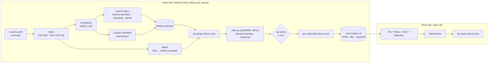

# Lights: code layout and data flow (milestone 1)

Architecture B as decided (DECISIONS Q1): a **hexagonal Rust core** (`lgu-core`) with **CQRS-style
materialised read models**, delivered **Jamstack**-style. Milestone 1 builds "A first": the batch adapter
(CLI in GitHub Actions) and the browser adapter (WASM in a Web Worker). The Cloudflare Worker API is the
third driving adapter and comes later, same-origin under `/api/*` on the Pages project (Build notes B9).



## Repository layout

| Path | What | Pattern role |
|---|---|---|
| `crates/lgu-core` | Panel, **feature derivation** (the only implementation; training reads its output), LightGBM tree evaluator, conformal intervals, CV tiers, fixed breaks, what-if, binary snapshot codec. No I/O, no async; deps `serde`/`serde_json` only | the hexagon |
| `crates/lgu-store` | Parquet feature-store reader → `Panel`; atomic file sink | driven adapters |
| `crates/lgu-cli` | `lgu design`, `lgu parity`, `lgu materialise` | driving adapter (batch) |
| `crates/lgu-wasm` | raw C-ABI what-if module for a Web Worker (157 kB, 64 kB gzipped) | driving adapter (browser) |
| `pipeline/` | uv/Python: `sources.yaml` (archivekit registry), `lgu/` (labels, boundaries, Earth Engine, LAADS + exactextract, features, training), `inputs/` (committed labels; see B4), `tools/` | write side (offline) |
| `web/` | Vite + React 19 + Akari + MapLibre static site | read side |
| `.github/workflows/` | `rust.yml`, `pipeline.yml`, `web.yml` (checks), `data.yml` (full data run) | CI |
| `spike/` | the 2026-10-21 measurement spike (throwaway) | — |

Dependency rule: `lgu-core` depends on nothing with I/O; `lgu-store` and the adapters depend on the core,
never the reverse. Python never re-implements a feature: it trains on the design matrix the Rust CLI wrote.

## Data flow, file by file

| Step | Command | Output (data/, gitignored) |
|---|---|---|
| inputs | `uv run python -m lgu inputs` (archivekit; needs `ARCHIVE_READ_TOKEN` in CI) or `inputs-direct` (B4) | `raw/psa/*.xlsx`, `raw/boundaries/*`, provenance sidecars, `interim/provenance.json` |
| boundaries | `lgu boundaries` | `interim/adm3.parquet` (GeoParquet, full resolution), `lgus.parquet`, `provinces.json`, `tiles/*.geojsonl` |
| labels | `lgu labels` | `build/labels.parquet`, `crosswalk-report.json` (+ committed copy in `pipeline/inputs/`) |
| zonal | `lgu zonal-ee`, `lgu zonal-bm` (`zonal-vj` optional) | `interim/zonal_*.parquet` |
| features | `lgu features` (gated: row counts, ranges, missing values) | `build/features.parquet` |
| design | `target/release/lgu design --build data/build --out data/build/design.csv` | one row per (LGU, year) with a previous PSA round; labelled rows = round years |
| train | `lgu train` | `build/model/{model.json, backtest-2018/2021/2023.json, metrics.json, expected.csv}` |
| parity | `lgu parity --model … --expected expected.csv --column <model>` | fails the run if \|core − LightGBM\| > 1e-5 |
| materialise | `lgu materialise …` | `dist/<version>/` (below) |
| tiles | `tools/build_tiles.sh geometry …` once per boundary vintage; `… join …` per version | `dist/<version>/tiles/{z}/{x}/{y}.pbf`, `lgu.pmtiles` |

## Read models (one immutable folder per data version)

`latest.json` → `{"version": "v1", "base": "v1/"}` is flipped only after a version is complete (rollback = flip back).

| File | Content |
|---|---|
| `manifest.json` | version, generated_at, git_sha, years 2012–2025, rounds, breaks [10, 20, 30, 40], tier thresholds, model name/version/what-if widening, counts, archivekit provenance (`data_as_of`, fallbacks) |
| `index.json` | LGUs (`p` pcode, `n` name, `pv` province, `r` region, `c` class, `x`/`y`), provinces (bbox for drill-down), regions |
| `lgu/<pcode>.json` | per year: `official` (PSA estimate, SE, CV, 90 % CI, tier, estimator ELL/Census EB), `model` (estimate, 50/90 % intervals, CV, tier, `from` round, `kind` backtest/between/nowcast), `shown` (what the map draws and its source), `inputs` (radiance, lit fraction, NDVI, population) |
| `metrics.json` | the validation leaderboard (folds F1–F3, baselines, ablation, calibration, tuning) |
| `tiles/` | MVT z0–10, layer `lgu` with `v12…v25` (value), `t12…t25` (tier), `s12…s25` (0 official, 1 model) per S1; layer `prov` |
| `whatif/` | `snapshot.bin` (panel, f32) and `model.json` for the WASM what-if |
| `estimates.csv` / `.parquet` | the long table (also published with the data release) |

**Which value the map shows:** the PSA official estimate in round years; otherwise the model estimate
from the latest earlier PSA round (`between` for 2013–2022 gaps, `nowcast` for 2024–2025). In round years
the panel also shows the **backtest**: what a model trained only on earlier rounds would have said.

## Model v2 (see docs/DECISIONS.md, "v2 enhancement", and `metrics.json`)

LightGBM on the change since the last PSA round **relative to the LGU's province**: the training target is
the LGU's change minus the mean change of its province in the same transition, so the model learns how a
place moves within its province (mean reversion, persistence of the previous trend) and carries the
province's level forward; provincial shifts between rounds are not predictable from these inputs and stay
in the interval. 19 features derived in `lgu-core::features` (unchanged from v1), five-seed average,
monotone constraints on radiance growth and radiance per person, hyper-parameters tuned by inner
forward-chaining inside each training window (scored on the within-province error), split-conformal
50/90 % intervals from residuals on rounds the model had not seen, binned by the previous official level;
model CV = (90 % half-width / 1.645) / estimate, tiers at 10/20 %. The estimate is still
`clamp(official_r + forest(x), 0, 100)`, so the core, the snapshot and `model.json` keep their v1 format.
Validated forward-chaining: F1 → 2018, F2 → 2021, F3 → 2023 (headline), with carry-forward, drift and
no-satellite baselines on the same rows.

## Local commands (fanless laptop: `taskpolicy -b`, `-j 2`)

```sh
export PATH=$HOME/.rustup/toolchains/stable-aarch64-apple-darwin/bin:$PATH
taskpolicy -b cargo test -j 2 -p lgu-core                      # unit + parity fixture
taskpolicy -b cargo build -j 2 --release -p lgu-cli
taskpolicy -b cargo build -j 2 --profile wasm --target wasm32-unknown-unknown -p lgu-wasm
cd pipeline && uv sync --group sources --group train && uv run pytest -q
gh release download data-v1 -R abrycta/lgu-lights -p 'read-models-v1.tar.zst'   # then web/scripts/link-data.sh
```

The full data run happens in Actions only (`data.yml`). Until the workflow is on `main`, a run is
requested by committing `.github/data-run.json`.
